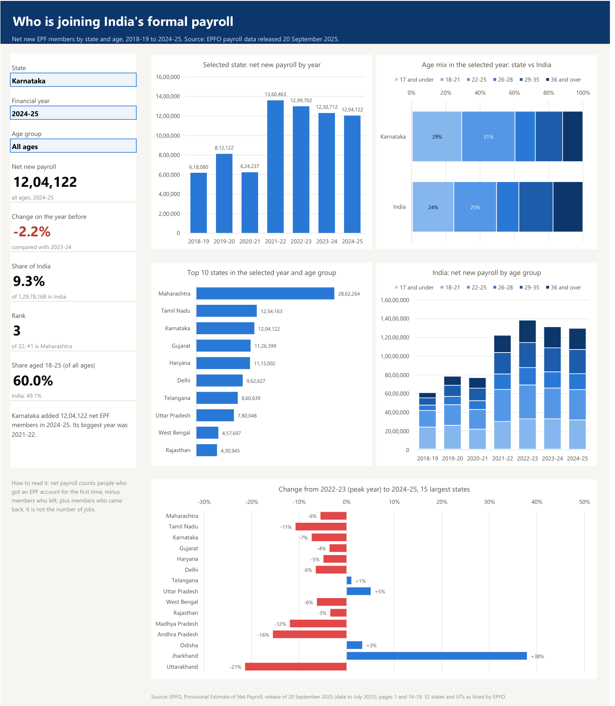

# Who is joining India's formal payroll: an Excel dashboard

Every month EPFO publishes how many people joined the Employees' Provident Fund, the savings scheme that comes with most formal jobs in India. I wanted to see in which states people are joining, how old they are, and how that changed from 2018-19 to 2024-25. The data only comes as a PDF, so I pulled the state tables out of it with Power Query and built the analysis and dashboard in Excel.

## Findings

Net payroll here means new EPF members, minus members who left, plus members who came back. It counts EPF accounts, not jobs.

Net additions more than doubled and then levelled off. They went from 61.1 lakh in 2018-19 to a peak of 1.39 crore in 2022-23, and were 1.30 crore in 2024-25, which is 6.3% below the peak. The big jump was 2021-22 (+58.7%), the year after Covid.

The people joining are getting older. In 2018-19, 67.3% of net additions were aged 18 to 25. By 2024-25 it was 49.1%. The 18-25 group grew from 41.1 lakh to 63.7 lakh, but the 26-and-over group grew from 19.0 lakh to 65.4 lakh, so it is now the bigger one.

Five states account for most of it. Maharashtra, Tamil Nadu, Karnataka, Gujarat and Haryana had 58.3% of net additions in 2024-25. Maharashtra alone had 22.1%, down from 25.8% in 2018-19, because other states grew faster: Odisha's additions in 2024-25 were 6.4 times its 2018-19 figure and Uttar Pradesh's were 3.1 times.

26 of the 32 states and UTs added fewer members in 2024-25 than in 2022-23, India's peak year. Uttar Pradesh (+5.1%), Odisha (+3.3%) and Telangana (+1.0%) are among the few that grew. Jharkhand shows +37.9%, but almost all of that is one jump in the over-35 group. Without that group it is +2.5%.

The age mix differs a lot by state. In Karnataka and Bihar about 60% of 2024-25 additions were aged 18 to 25. In Odisha it was 38.9% and in Jharkhand 24.6%.

## Data

The source is EPFO's [Provisional Estimate of Net Payroll](https://www.epfo.gov.in/data-hub/), released on 20 September 2025, with data up to July 2025. That was the latest release on the EPFO data hub when I downloaded it. It is a [24-page PDF](https://pmvbry-cdn.epfindia.gov.in/wp-content/uploads/2025/10/September-2025.pdf). I used the six state tables on pages 14 to 19, one for each age group, and the all-India table on page 1 as a check.

Getting the tables out of the PDF took most of the work:
- The report title and the age group are written inside the table, above the real header. The only place the age group appears is a title cell like `Age Bucket: 18-21`.
- The first column header is split over three lines (`2017-18 / From Sep- / 17`) and covers only September 2017 to March 2018.
- Full years and months are mixed in one table: 2017-18 to 2024-25, then `Apr-25` to `Jul-25`. Page 1 writes the months as `Apr-2025`.
- Each page lists the states in a different order, because every page is sorted by its own numbers. So rows can only be matched by state name, never by position.
- Every page has a `SUB TOTAL` row and a page footer, and the last page also has `Grand Total`.
- State names are in capitals with old spellings, such as `ORISSA` and `CHATTISGARH`.
- Only 32 states and UTs are listed. Jammu and Kashmir and Ladakh are 0 for 2017-18 and 2018-19 in every age group.
- 59 values are negative. That can be correct, because more people can leave than join.
- One value looks wrong. In Bihar the over-35 group is 25,182 in 2019-20, 250,428 in 2020-21 and 24,075 in 2021-22. I kept it, because it is inside EPFO's own totals, but flagged it. Bihar's 2020-21 total depends on it.

After cleaning there are 2,304 rows: 32 states, 6 age groups and 12 periods. For every period and age group, my state rows add up exactly to EPFO's SUB TOTAL rows. Against the all-India table on page 1 they match from 2019-20 onwards. In 2017-18 and 2018-19 there are gaps of up to 5 people, which are in the source.

## How the workbook is built

- Power Query: `fnStatePage` cleans one PDF page. It reads the age group from the title cell, skips to the `State` header, renames the first period, drops the subtotal rows and unpivots. `payroll_raw` runs it on every PDF page whose first column contains `State`. `payroll` adds PeriodType (Year, Month, Part year), FY and a month date, and fixes the labels and types. `india_totals` reads page 1 for the checks. The M code is in `queries.pq`.
- Data: the `payroll` table, plus State, Region, AgeOrder, Band and AgeLabel columns made with `XLOOKUP` on the `StateMap` and `AgeMap` tables. AgeLabel renames EPFO's 'Less than 18' and 'More than 35' to 17 and under and 36 and over, so the age groups sort in order.
- States: a state-by-year grid built from three formulas. `SORTBY` sorts the states, `TRANSPOSE(YearList)` puts the years across, and one `SUMIFS` fills the grid. It has a colour-scale heat map, data bars for share, and columns for the change from 2022-23 (India's peak year) to 2024-25 and the share aged 18-25. A `FILTER` list shows the states that added fewer members in 2024-25 than in 2022-23.
- Pivots: three PivotTables (region by year, age band share by state, age by year), with slicers for year, region and age group.
- Dashboard: three dropdowns (state, year, age group) built with data validation on named lists. For the chosen state, year and age group it shows net payroll, the change on the year before, share of India, rank and the share aged 18-25, plus a short sentence and charts of the trend, the age mix and the top 10 states. Rank uses `MATCH` and the best year uses `INDEX`/`MATCH`.
- Cleaning: a log of every problem above and the query step that handles it. Checks: the state rows against page 1, counts of unmapped, negative and zero rows, and the two flagged values.

All the formulas are in `formulas.md`. To refresh it, open Data > Queries & Connections, change the SourceFile parameter to the full path of data\epfo_payroll_september_2025.pdf on your machine (for example C:\...\india-epfo-payroll-excel\data\epfo_payroll_september_2025.pdf) and click Refresh All.

## Files

- `epfo_payroll.xlsx`: the workbook
- `queries.pq`: the Power Query (M) code
- `formulas.md`: the formulas behind the States, Calc, Dashboard and Checks sheets
- `dashboard.pdf`: the dashboard as a one-page PDF
- `data/`: the EPFO PDF
- `fetch_data.py`: downloads the PDF
- `prepare.py`: does the same extraction in Python (PyMuPDF and pandas), which I used to check the workbook. It writes `payroll_clean.csv` and `control_check.csv`.
- `analysis.py`: works out every number in this README into `facts.json`

## Limits

Net payroll is not the number of new jobs. It counts EPF accounts, includes temporary workers, and EPFO revises it every month. A newer release would give slightly different numbers for the same years.

The state is where the employer's EPF account is, not where the person lives or works. Sikkim, Puducherry, Lakshadweep and Dadra & Nagar Haveli and Daman & Diu are not in the state tables at all.

I only used the state tables. The industry tables in the same PDF show only the top 10 industries for each age group, and one of them has a wrong header (`Sep-05` instead of `2024-25`), so I left them out.

Tools: Excel (Power Query from PDF, XLOOKUP, SUMIFS, INDEX/MATCH, dynamic arrays, PivotTables, slicers, charts), Python (PyMuPDF, pandas) for checking
